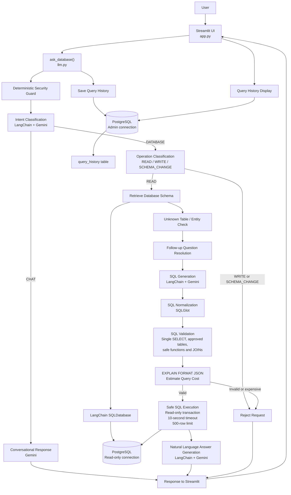

# LangChain Text-to-SQL Chatbot

An LLM-powered conversational application that converts natural-language questions into SQL queries and retrieves information from a PostgreSQL database.

The application uses LangChain and Google's Gemini model to understand user questions, generate schema-aware SQL queries, validate them, and return results through an interactive Streamlit interface.

## 🚀 Features

- **Natural Language to SQL:** Ask questions in plain English instead of writing SQL manually.
- **LLM Integration:** Uses LangChain with Google's Gemini model.
- **Schema Awareness:** Dynamically retrieves database tables, columns, data types, and relationships.
- **SQL Validation:** Uses SQLGlot to parse and validate generated SQL queries.
- **Read-Only Execution:** Uses a dedicated read-only PostgreSQL database connection.
- **SQL Safety:** Restricts execution to approved SELECT statements.
- **Query Cost Analysis:** Uses PostgreSQL EXPLAIN to estimate query execution cost.
- **Query Timeouts:** Implements statement timeouts to prevent long-running queries.
- **Result Limiting:** Restricts the number of returned rows.
- **Security Checks:** Handles destructive requests, unknown tables, invalid columns, and potentially malicious inputs.
- **Interactive Interface:** Built with Streamlit, featuring conversational interactions and query history.

## 🛠️ Technology Stack

| Technology | Purpose |
|---|---|
| Python | Core programming language |
| Streamlit | User interface |
| LangChain | LLM orchestration |
| Google Gemini | Natural-language understanding and SQL generation |
| PostgreSQL | Relational database |
| SQLAlchemy | Database connectivity |
| SQLGlot | SQL parsing and validation |
| Pandas | Query result handling |
| Python-dotenv | Environment configuration |

## 🏗️ Project Structure

```text
LANGCHAIN_TEXT_TO_SQL/
│
├── app.py              # Streamlit application
├── database.py         # Database connections and configuration
├── llm.py              # LLM integration and SQL processing
├── requirements.txt    # Python dependencies
├── .gitignore          # Files excluded from Git
├── README.md           # Project documentation
│
├── .env                # Environment variables (not uploaded)
└── venv/               # Virtual environment (not uploaded)
```

## 🧩 System Architecture



## ⚙️ Installation and Setup

### 1. Clone the repository

```bash
git clone https://github.com/jeetbhindora/langchain-text-to-sql-chatbot.git
```

### 2. Navigate to the project directory

```bash
cd langchain-text-to-sql-chatbot
```

### 3. Create a virtual environment

```bash
python -m venv venv
```

### 4. Activate the virtual environment

Windows PowerShell:

```bash
venv\Scripts\Activate
```

### 5. Install dependencies

```bash
pip install -r requirements.txt
```

### 6. Configure environment variables

Create a `.env` file in the project root directory.

Add your Gemini API key and PostgreSQL connection credentials. Use the exact variable names expected by the project's configuration files.

**Never upload your `.env` file or expose your API keys and database passwords.**

### 7. Run the application

```bash
streamlit run app.py
```

The application will open in your browser.

## 🔒 Security and SQL Safety

The application incorporates multiple layers of protection:

- SQLGlot-based SQL parsing and validation.
- Single-statement SELECT-only execution.
- Read-only PostgreSQL database access.
- Restrictions on destructive SQL operations.
- Unknown table and column handling.
- SQL injection and unsafe-function checks.
- Query execution timeouts.
- Query cost estimation.
- Maximum result row limits.

## 🧪 Testing

The application has been tested for:

- Valid SQL generation and execution.
- Multi-table JOIN operations.
- Aggregations and sorting.
- Unknown table and column requests.
- Destructive SQL requests.
- SQL injection through natural-language prompts.
- Credential and restricted database information requests.
- CROSS JOIN restrictions.
- Query cost limits.
- PostgreSQL statement timeouts.

The consolidated regression suite of 10 positive and negative test cases passed.

## 🎯 Project Objective

The objective of this project is to make relational databases more accessible by allowing users to retrieve information through natural-language conversations while maintaining database security and controlled SQL execution.

## 👨‍💻 Author

**Jeet Bhindora**

GitHub: [@jeetbhindora](https://github.com/jeetbhindora)

---

*Built using Python, LangChain, Google Gemini, PostgreSQL and Streamlit.*